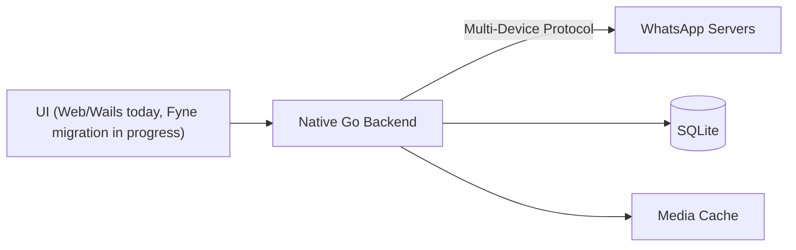

# what4winnative

**what4winnative** is a personal fork of [lugvitc/whats4linux](https://github.com/lugvitc/whats4linux), customized for a Windows-native workflow and ongoing UI experiments.

> This project is **not affiliated with** lugvitc, WhatsApp, or Meta.  
> It is an unofficial WhatsApp client fork. Use at your own risk.

## Fork status

- **Upstream:** [lugvitc/whats4linux](https://github.com/lugvitc/whats4linux)
- **Fork maintainer:** [@adtbch](https://github.com/adtbch)
- **License:** [GNU AGPL v3.0](./LICENSE) (same as upstream; required for forks/modifications)
- **Current work:** migrating the UI layer toward [Fyne](https://fyne.io/) on branch `fyne-migration` while keeping the existing Go backend (`api/`, `internal/`, WhatsMeow) reusable.

This fork keeps upstream attribution and the AGPL license. If you redistribute binaries or provide network access to a modified version, you must make the corresponding source available under AGPL-3.0 terms.

## What this fork is doing

The upstream project uses a native Go backend with a lightweight web-rendered UI (Wails/WebKit). `what4winnative` is exploring a more Windows-native desktop UI path:

- Preserve the WhatsApp multi-device backend logic (WhatsMeow-based)
- Replace/port the frontend incrementally to Fyne
- Fix Windows-specific behavior and local workflow issues as they come up

Because this is an active fork, behavior and build instructions may differ from upstream. Check commit history and open issues in this repo for the current state.

## Architecture (inherited from upstream, evolving)



Core responsibilities remain in Go:
- WhatsApp protocol and crypto (via WhatsMeow)
- Message sync, storage, and pagination
- Media handling
- App state and IPC/events between backend and UI

## Building (Wails/upstream path)

> Requirements and steps may change during the Fyne migration. If a step fails, check recent commits or build scripts in this repo.

```bash
git clone https://github.com/adtbch/what4winnative.git
cd what4winnative
wails build
```

Build output is typically placed in `build/bin/`.

## Fyne migration (work in progress)

Migration plan and progress live in:
- `docs/superpowers/plans/2025-11-07-fyne-migration.md` (branch `fyne-migration`)

The goal is to keep backend behavior intact while rebuilding the UI layer in Go/Fyne.

## Credits

- Original project: [whats4linux](https://github.com/lugvitc/whats4linux) by [lugvitc](https://github.com/lugvitc) and contributors
- WhatsApp protocol library: [whatsmeow](https://github.com/tulir/whatsmeow)

## License

[AGPL-3.0](./LICENSE). This fork retains the upstream license and attribution.
